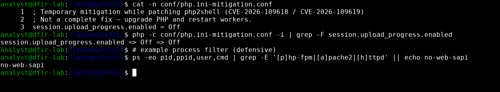
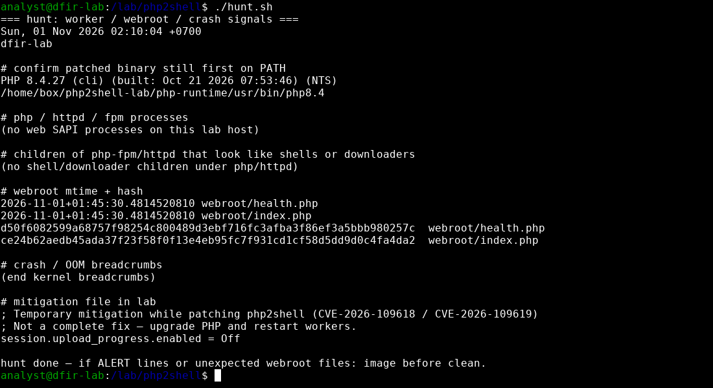

# php2shell (CVE-2026-109618 / CVE-2026-109619) — Lab Verification & IR Note

> **Defensive scope only.** Read-only checks, logging rules and mitigation config. No exploit steps, payloads or PoC.
>
> 📝 Full write-up on Medium: https://medium.com/@mqtsquad420/php2shell-cve-2026-109618-cve-2026-109619-lab-verification-ir-note-416ab7a1840b

**Repo layout:** `scripts/inventory.sh`, `scripts/hunt.sh` (read-only, lab paths — adapt `cd`/PATH), `scripts/defender-one-liners.txt`, `conf/php.ini-mitigation.conf`, `screenshots/`.

**Author:** Pongsathorn Parivutthipong · **Date:** 2026-11-01 (UTC+7) · **Scope:** defensive patch/mitigation verification on an isolated lab host. No exploit traffic was sent; no PoC is included.

## 1. Lab identity

| Item | Value |
|---|---|
| Host | `dfir-lab` (isolated), Linux 6.12.94+ x86_64 |
| PHP binary | `/lab/php2shell/bin/php` -> `<lab-runtime>/usr/bin/php8.4` (symlink) |
| Build | `PHP 8.4.27 (cli) (built: Oct 21 2026 07:53:46) (NTS)`, Built by Debian, Zend Engine v4.4.27 |
| SAPI checked | `cli` only. Production must also check FPM pools / Apache mod_php workers — the CLI version says nothing about a long-running worker that was not restarted. |
| Webroot baseline | `health.php` `d50f6082…257c`, `index.php` `ce24b62a…4da2` (sha256) |

## 2. Advisory tracker

- **CVE-2026-109618, CVE-2026-109619** — critical memory-safety bugs in the PHP engine, collectively tracked as "php2shell". Under triage here.
- **115560** — informational only; not in scope for this note.

[CISA alert, 2026-10-21](https://www.cisa.gov/news-events/alerts/2026/10/21/critical-vulnerabilities-php-require-immediate-patching) urges immediate upgrade to the fixed branches below and points defenders to detection content in CISA's public SIGMA repository. The [Qualys write-up](https://blog.qualys.com/vulnerabilities-threat-research/2026/10/20/php-announces-critical-security-release-for-two-vulnerabilities) describes the issue as reachable over normal web requests on unpatched workers, which is why process ancestry and webroot integrity are the main hunt signals. See also [php.net releases](https://www.php.net/releases/).

## 3. Patch matrix (source: CISA 2026-10-21)

| Branch | Fixed in |
|---|---|
| 8.5 | 8.5.12 |
| 8.4 | 8.4.27 |
| 8.3 | 8.3.36 |
| 8.2 | 8.2.35 |

Note: emergency security releases can bump patch levels faster than the usual monthly cadence, so the numbers look high but are the ones published. Distro packages (Debian/Ubuntu/RHEL) often backport the fix into an older upstream version string — verify the vendor advisory ID / package changelog (`apt changelog php8.4`, `rpm -q --changelog php`), not just `php -v`.

## 4. Mitigation verified in lab

```ini
; conf/php.ini-mitigation.conf — temporary, not a fix
session.upload_progress.enabled = Off
```

```console
$ php -c conf/php.ini-mitigation.conf -i | grep upload_progress.enabled
session.upload_progress.enabled => Off => Off
```

Result: lab runtime is 8.4.27 (at the patched floor) and the mitigation directive loads. In production, put it in the FPM pool / Apache ini and **restart every worker**.



## 5. Hunt commands used (copy-paste)

```bash
# version + real binary path
php -v
readlink -f "$(which php)"
php -r 'echo PHP_VERSION, " SAPI=", PHP_SAPI, chr(10);'

# web SAPI processes
ps -eo pid,ppid,user,cmd --sort=pid \
  | grep -E '[p]hp-fpm|[p]hp-cgi|[a]pache2|[h]ttpd|[f]rankenphp'

# ancestry: children of php-fpm/httpd that look like shells/downloaders
ps -eo pid=,ppid=,user=,cmd= \
  | awk 'NR==FNR { p[$1]=1; next }
         ($2 in p) && $0 ~ /(^|\/)(sh|bash|dash|curl|wget|python|perl|nc|ncat)( |$)/' \
       <(ps -eo pid=,cmd= | awk '/php-fpm: pool|apache2|httpd|php-cgi/ { print $1 }') \
       -

# webroot integrity
find /var/www -type f -mtime -7 -ls
find /var/www -type f -name '*.php' -newer /var/tmp/baseline.stamp -print
find /var/www -type f -print0 \
  | sort -z \
  | xargs -0 sha256sum > /var/tmp/webroot.sha256

# large multipart POSTs around the disclosure window
zgrep -E 'POST .*\.php' /var/log/nginx/access.log* \
  | awk '$10+0 > 1000000'

# kernel crash / OOM breadcrumbs
journalctl -k -b --no-pager \
  | grep -Ei 'php|segfault|oom' \
  | tail -n 20
dmesg -T \
  | grep -Ei 'php|segfault|oom' \
  | tail -n 10
```

Output on `dfir-lab` (quiet, as expected — no web SAPI running):

```text
(no web SAPI processes on this lab host)
(no shell/downloader children under php/httpd)
2026-11-01+01:45:30 webroot/health.php
2026-11-01+01:45:30 webroot/index.php
(end kernel breadcrumbs)   # no segfault/OOM lines
```



## 6. Detection ideas

auditd (persist in `/etc/audit/rules.d/php_shell.rules`):

```text
-a always,exit -F arch=b64 -S execve -F path=/usr/bin/bash -F key=php_shell
-a always,exit -F arch=b64 -S execve -F path=/bin/sh -F key=php_shell
```

```bash
ausearch -k php_shell -i | grep -E 'ppid='
# then resolve that ppid to php-fpm/httpd
```

Sigma-style sketch (align with CISA's SIGMA repo content referenced in the alert):

```yaml
title: Shell or downloader spawned by PHP web worker
logsource:
  category: process_creation
  product: linux
detection:
  parent:
    ParentImage|endswith:
      - '/php-fpm'
      - '/php-fpm8.4'
      - '/httpd'
      - '/apache2'
  child:
    Image|endswith:
      - '/sh'
      - '/bash'
      - '/dash'
      - '/curl'
      - '/wget'
  condition: parent and child
level: high
```

Expect false positives from legitimate `exec()`/`shell_exec()` in apps (image converters, mailers) — baseline first.

## 7. Crash / core handling policy

- **Do NOT reproduce the bug to obtain a core.** Only work with crashes that already happened.
- `coredumpctl list | grep -i php` — if a worker already crashed, `coredumpctl dump <PID> -o php-worker.core` and keep it with its hash.
- Record the binary build ID (`readelf -n` on the php/php-fpm binary) so the core can be symbolised later against the exact package.
- Correlate crash timestamp with access/error logs (request ID, client IP, URI) — the goal is scope and attribution, not studying the use-after-free.
- Heap analysis (`gdb` `bt`, `info proc mappings`) only on a copy, offline, by someone authorised.
- If a shell child or unexpected webroot file appears: snapshot/image the host before cleaning.

## 8. 24h ops checklist

1. Inventory every PHP install (CLI, FPM, Apache, containers); note branch and package source.
2. Upgrade to the fixed version or confirm vendor backport by advisory ID.
3. Until patched: `session.upload_progress.enabled = Off`, restart workers.
4. Verify running workers' start time is after the upgrade (`ps -o lstart= -p <pid>`).
5. Run the hunt commands; diff webroot hashes against baseline.
6. Turn on auditd/Sigma rule; review hits after 24h.
7. Preserve any pre-existing PHP cores; escalate if shell children were seen.

## 9. References

- CISA: https://www.cisa.gov/news-events/alerts/2026/10/21/critical-vulnerabilities-php-require-immediate-patching
- CISA SIGMA repo (linked from the alert)
- PHP releases: https://www.php.net/releases/
- Qualys php2shell write-up

## Disclaimer

Defensive lab note. Commands are read-only checks or logging rules. No exploitation steps, payloads or proof-of-concept are provided or were run.
